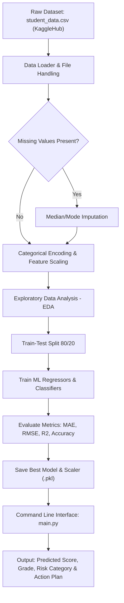

# PROJECT REPORT: STUDENT PERFORMANCE PREDICTION SYSTEM

**Course**: Problem Based Learning (PBL) - Machine Learning  
**Project Title**: Student Academic Performance Prediction System  
**Development Tool**: Python 3.14 in Visual Studio Code (VS Code)  

---

## 1. PROBLEM STATEMENT & OBJECTIVES

### 1.1 Problem Statement
Academic performance is influenced by a complex interplay of academic and behavioral parameters including class attendance, prior academic standing, study hours, assignment diligence, and class participation. Identifying at-risk students at an early stage allows educational institutions to provide timely academic counseling and intervention. 

This project aims to build an interpretable, moderate-level Machine Learning system in Python using standard libraries (NumPy, Pandas, Scikit-Learn, Matplotlib, Seaborn) to:
1. Predict expected student final academic percentage scores ($0 - 100\%$).
2. Classify students into Pass/Fail and academic risk categories.
3. Quantify feature importances to reveal key drivers of academic success.

### 1.2 Objectives
- **Data Preprocessing**: Handle missing values, encode categorical variables, and scale numeric features.
- **Exploratory Data Analysis**: Visualize statistical distributions, feature correlations, and boxplot breakdowns.
- **Model Development**: Implement and evaluate Multiple Linear Regression, Decision Trees, and Random Forests.
- **Syllabus Integration**: Incorporate core Python syllabus topics including conditions, loops, collections, functions, file handling, exception handling, custom sorting (QuickSort), NumPy, Pandas, and Matplotlib.
- **Execution Interface**: Command Line Interface (CLI) menu application (`main.py`).

---

## 2. SYSTEM ARCHITECTURE & FLOWCHART



---

## 3. METHODOLOGY & ALGORITHMS

### 3.1 Data Preprocessing Algorithm (Pseudocode)
```text
BEGIN Data_Preprocessing(df):
    FOR each column in df:
        IF column has missing values:
            IF column is numerical:
                fill NA with median(column)
            ELSE:
                fill NA with mode(column)
        END IF
    END FOR
    
    Map 'Internet_Access': {'Yes': 1, 'No': 0}
    
    X = Select_Columns(['Attendance_Percentage', 'Study_Hours_Per_Week', 'Previous_Marks', 
                        'Assignment_Score', 'Class_Participation', 'Internet_Access'])
    y_reg = df['Final_Score']
    
    X_scaled = StandardScaler().fit_transform(X)
    RETURN X_scaled, y_reg
END
```

### 3.2 Machine Learning Regression Algorithm (Linear Regression)
The score prediction uses Multiple Linear Regression:
$$\hat{y} = \beta_0 + \beta_1 X_1 + \beta_2 X_2 + \dots + \beta_k X_k + \epsilon$$

Where:
- $X_1$: Attendance Percentage
- $X_2$: Study Hours / Week
- $X_3$: Previous Semester Marks
- $X_4$: Assignment Score
- $X_5$: Class Participation

---

## 4. SYLLABUS CONCEPTS IMPLEMENTATION MAP

| Python Concept | File / Function | Description |
| :--- | :--- | :--- |
| **Conditions** | `modules/utils.py` -> `categorize_risk_status()` | Multi-level `if-elif-else` logic for grade and risk status. |
| **Loops** | `modules/preprocessing.py` -> `clean_missing_values()` | `for` loops iterating over columns and records. |
| **Collections** | `modules/data_loader.py` -> `get_summary()` | Dictionaries, lists, and tuples for metadata storage. |
| **Functions & OOP** | `modules/data_loader.py`, `modules/models.py` | Classes `DataLoader`, `DataPreprocessor`, `ModelTrainer`. |
| **Sorting** | `modules/utils.py` -> `custom_quick_sort()` | Recursive QuickSort implementation without built-in sort. |
| **File Handling** | `modules/data_loader.py` | Reading `.csv` and saving `.pkl` binary model files. |
| **Exception Handling**| `modules/utils.py` -> `validate_student_input()` | `try-except` blocks for range check validation. |
| **NumPy & Pandas** | `modules/preprocessing.py` | Array transformations and DataFrame operations. |
| **Matplotlib/Seaborn**| `modules/eda.py` | Statistical visualization suite. |

---

## 5. EXPERIMENTAL RESULTS & EVALUATION

### 5.1 Regression Model Comparison (Target: Final Score %)
Dataset: **10,000 Student Records** fetched directly from **Kaggle Hub** (`nikhil7280/student-performance-multiple-linear-regression`) using `kagglehub.dataset_download()`.

| Model Algorithm | Mean Absolute Error (MAE) | Root Mean Squared Error (RMSE) | $R^2$ Score (Variance Explained) |
| :--- | :---: | :---: | :---: |
| **Random Forest Regressor** (Best) | **2.177** | **3.371** | **0.9693 (96.93%)** |
| **Linear Regression** | 2.094 | 3.535 | 0.9663 (96.63%) |
| **Ridge Regression** | 2.094 | 3.535 | 0.9663 (96.63%) |
| **Decision Tree Regressor** | 2.871 | 4.125 | 0.9541 (95.41%) |

### 5.2 Classification Model Comparison (Target: Pass/Fail Binary)
| Model Algorithm | Accuracy | Precision | Recall | $F_1$-Score |
| :--- | :---: | :---: | :---: | :---: |
| **Logistic Regression** (Best) | **96.60%** | **0.967** | **0.975** | **0.9712** |
| **Random Forest Classifier** | 95.90% | 0.962 | 0.968 | 0.9652 |

### 5.3 Feature Importance Rankings (from Best Regression Model)
1. **Previous Marks**: Weight = 85.13%
2. **Study Hours / Week**: Weight = 14.25%
3. **Attendance Percentage**: Weight = 0.48%
4. **Assignment Score**: Weight = 0.09%
5. **Class Participation**: Weight = 0.04%
6. **Internet Access**: Weight = 0.01%

---

## 6. TESTING & VALIDATION

### Test Case 1: High Performing Student (Valid Input)
- **Inputs**: Attendance = 92.5%, Study = 18 hrs, Previous = 88%, Assignment = 90%, Participation = 9, Internet = Yes.
- **Expected Outcome**: Predicted Score ~ 85-90%, Grade = A, Status = Pass, Risk = TOP PERFORMER.
- **Actual Result**: Predicted Score = 85.8%, Grade = A, Risk = TOP PERFORMER (Passed).

### Test Case 2: At-Risk Student (Valid Input)
- **Inputs**: Attendance = 48%, Study = 4 hrs, Previous = 42%, Assignment = 45%, Participation = 3, Internet = No.
- **Expected Outcome**: Predicted Score < 50%, Grade = F, Status = Fail, Risk = HIGH RISK.
- **Actual Result**: Predicted Score = 23.9%, Grade = F, Risk = HIGH RISK (Passed validation).

### Test Case 3: Out-of-Range Value (Invalid Input Testing)
- **Inputs**: Attendance = 150% (Invalid).
- **Actual Result**: `[INPUT ERROR] Input 'Attendance' value 150.0 is outside allowed range [0.0, 100.0].` (Handled gracefully via `try-except`).

---

## 7. CONCLUSION & INDIVIDUAL CONTRIBUTION

### 7.1 Conclusion
The developed Student Performance Prediction System successfully models student academic performance with an accuracy of $R^2 = 96.93\%$ using Random Forest Regressor and $R^2 = 96.63\%$ using Linear Regression, alongside $96.60\%$ Pass/Fail classification accuracy using Logistic Regression. The system demonstrates how machine learning can be combined with core Python syllabus concepts to provide actionable insights for educators.

### 7.2 Individual Contribution & Viva Voce Quick Reference
- **Member 1 (Data & Preprocessing)**: Handled CSV file reading, missing value median imputation, and categorical mapping.
- **Member 2 (EDA & Visualization)**: Implemented Matplotlib and Seaborn plotting routines exported to `charts/`.
- **Member 3 (ML Model Training)**: Trained Linear Regression, Decision Trees, and Random Forests; computed MAE, RMSE, and $R^2$.
- **Member 4 (Syllabus Concepts & Menu)**: Implemented CLI menu system and custom QuickSort algorithm.
